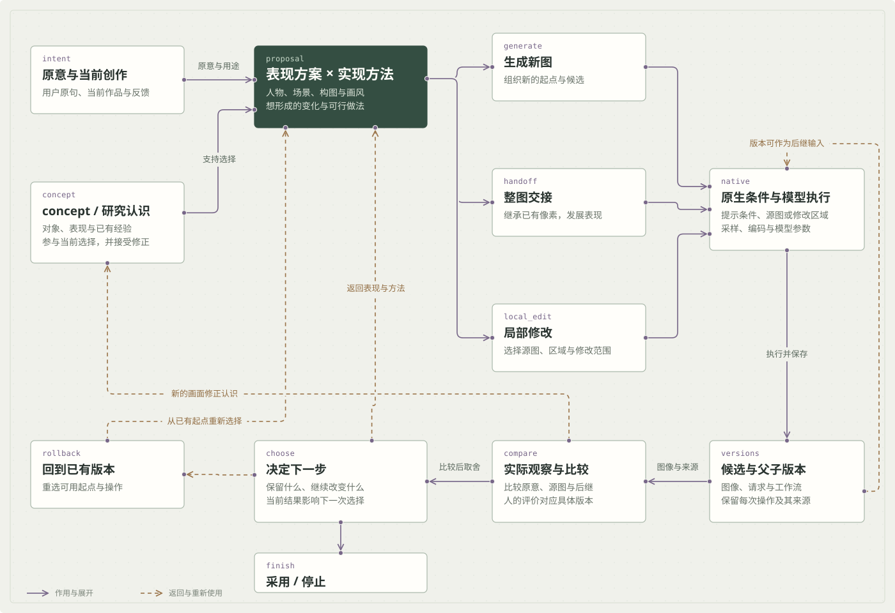

# 围绕作品继续发展的管线

创作中的问题会改变下一步制作方式。我将表现选择、模型条件、实际图像、版本与反馈组织在同一过程里，使它们能够共同参与作品的发展。

图示为结构与可选操作；每次创作围绕当前作品选择路径。

## 组合实验提供判断材料

公开案例采用两组已保存实验：Illustrious → NewBie 展示构图的继承与画面发展；同一张 NewBie 源图分别交给 Illustrious、Z-Image Turbo，比较柔和绘画处理与另一种轮廓、色块方向。

后两幅是从共同源图出发的独立分支。源图、每次操作条件和后继分别保留，比较后仍可返回共同起点。

源图和后继共同参与选择。采用、停止、回退与继续加工，都有各自用途。

## 表现与实现共同选择

简短构想还需要展开人物、动作、环境、构图与画风的关系，同时选择适合的生成或修改方法。用户原意和系统补充分别保留，后续结果可以使这些选择重新被考虑。

## 模型条件承接当前选择

管线对 NewBie、Illustrious、Anima Turbo 与 Z-Image 的条件和操作分别组织。提示条件、采样、编码与图像交接沿所选路径配置；某次创作可以使用一个模型，也可以在已有图像上继续交接。

## 图像、版本与下一步

| 当前需要 | 管线组织的作用 |
| --- | --- |
| 继承已有构图，继续塑造表现 | 将已有像素作为后继输入，组织整图交接和对应条件 |
| 集中修改某个局部 | 选取区域，限定修改范围，并保留源图用于比较 |
| 改变表现方案 | 返回构思与方法选择，组织新的生成候选 |
| 比较并采用作品 | 源图和中间版本共同提供判断与继续的起点 |

保存版本使过程有可返回的依据。人的选择与反馈继续参与制作，模型数量不规定每次创作的路线。

## 实际图像与反馈

源图已有的形式参与后继，整图交接和脸部细化可以共同改变结果；眼神、表情与发丝的变化又成为下一次判断的材料。人的反馈对应确切版本，保存评价与继续制作分别承接记录和执行。

## 我的工作

负责产品构思、创作管线与实验设计、画面取舍及迭代方向，结合 AI 协作实现模型工具接点和网页工作区。concept 中的对象与关系理解继续参与设计，使反馈能够返回表现、方法或当前修改范围。

[返回项目介绍](../../anime-pipeline-studio.html)
