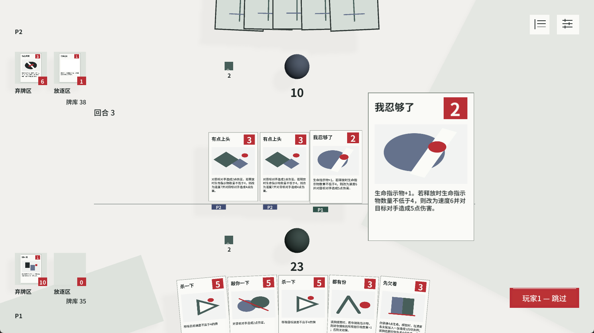
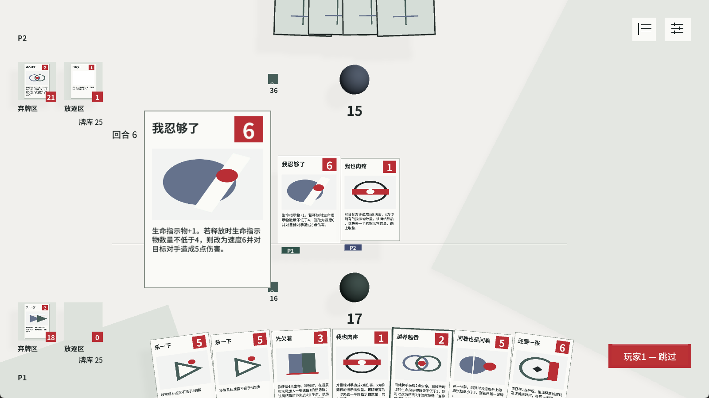
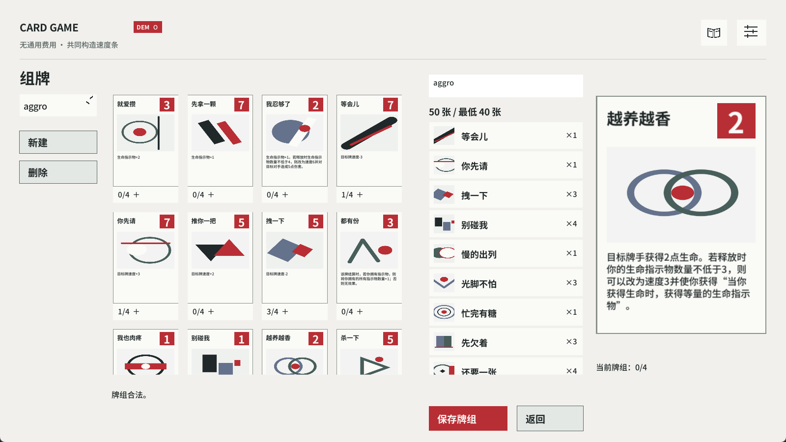

# 从积累到选择

我希望资源带来不同用途：改变当前行动，支持之后的增长，或在适当时机兑现。卡牌之间因此能够建立联系，玩家也可以根据当前局面决定保留什么。

## 积累门槛同时改变效果与速度

卡牌「我忍够了」通常以速度 2 取得 1 枚生命指示物；释放时拥有至少 4 枚，转为速度 6，并在结算时对对手造成 5 点伤害。

规则门槛示例：

| 释放时的生命指示物 | 速度 | 结算效果 |
| --- | --- | --- |
| 3 枚 | 2 | 获得 1 枚生命指示物 |
| 4 枚 | 6 | 对对手造成 5 点伤害 |

积累同时改变效果与先结算的机会。门槛在释放时读取并保存模式，之后取得指示物不会追溯改写这一张牌。玩家需要比较当前积累与之后的爆发，公开资源也为对手的回应提供线索。

### 实机中的两次释放

释放时 2 枚生命指示物，速度 2；结算时获得 1 枚指示物。

释放时 16 枚生命指示物，满足 4 枚门槛，速度 6；结算时对对手造成 5 点伤害。

两图来自同一局不同轮次的两次释放，均为结算前画面。

## 回复与后续积累

卡牌「越养越香」的基础效果使目标牌手获得 2 点生命。释放时拥有至少 3 个生命指示物，可以选择将它改为速度 3，并使自己获得持续能力：之后获得生命时，取得等量生命指示物。

| 当前选择 | 兑现的作用 | 留下的后续 |
| --- | --- | --- |
| 基础回复，速度 2 | 目标牌手获得 2 点生命 | 当前生命收益 |
| 持续能力，速度 3 | 自己获得回复转化为指示物的能力 | 后续回复继续推动积累 |

门槛增加选择。采用持续能力时替换本次基础回复，指示物不作为支付消耗；玩家是在当前收益与后续积累之间作出决定。

## 兑现后的资源保留

卡牌「我也肉疼」造成的伤害 X 等于自己拥有的指示物总数，结算后失去一半指示物，向上取整。例如拥有 5 个指示物时，造成 5 点伤害，再失去 3 个，保留 2 个。

这里读取全部指示物；前两张牌的条件读取生命指示物。资源的种类、数量和读取时机分别进入规则表达。

## 四张牌，三种保留

规则推演起点：双方生命均为 10；A 起手 5 张，为「换张看看」「突然不乖」「你先请」和两张保留牌，生命指示物为 0，牌库可抽牌。本例按以下牌张效果推演。

依次出牌：A 的「换张看看」（速度 3，指示物 +1，可支付 1 枚追加抽牌）；B 的「杀一下」（速度 5，指向前牌）；A 的「突然不乖」（速度 1，将要结算时手牌至少 3 张则对手受 3 伤，否则自己回复 3）。B 让过，A 决定下一步。

| A 的选择 | 结算后的手牌 | 生命指示物 | 双方生命 A / B | 保留的价值 |
| --- | --- | --- | --- | --- |
| 直接让过 | 3 | 0 | 10 / 7 | 保留「你先请」 |
| 打「你先请」，保护并支付抽牌 | 3 | 0 | 10 / 7 | 换来一次新抽牌 |
| 打「你先请」，保护并保留指示物 | 2 | 1 | 13 / 10 | 资源与回复 |

「你先请」速度 7，使「换张看看」速度从 3 变为 6，因而先于「杀一下」结算；目标离开速度条后，移除效果失去目标。是否抽牌又改变「突然不乖」读取的手牌条件。

## 让设计进入数据与执行

我将牌义中的时机、条件、可选模式和效果拆开，使它们能够由内容数据承接。「越养越香」在释放时读取门槛并取得模式选择，结算时按所选模式执行回复或持续能力。

[数据样例](../cards.json)取自项目现有规则数据，保留上述机制与四牌推演涉及的八张牌。其中的内部 ID 用于查找与模式对应；页面介绍沿正式牌名展开。

## 从单牌进入整个系统

积累与兑现还进入共享速度条。先后结算会改变目标是否仍在、资源何时取得和条件能否成立；继续投入一张保护牌，也会改变手牌数量与之后的选择。我围绕这些关系组织内容，使规则和实际交互共同承接玩家的决定。

[项目与试玩入口](../../speed-card-game.html)
