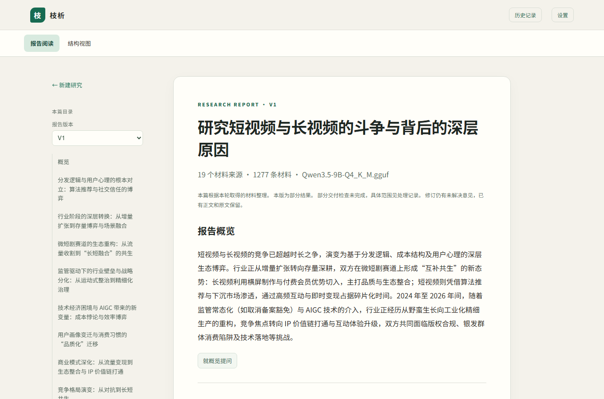
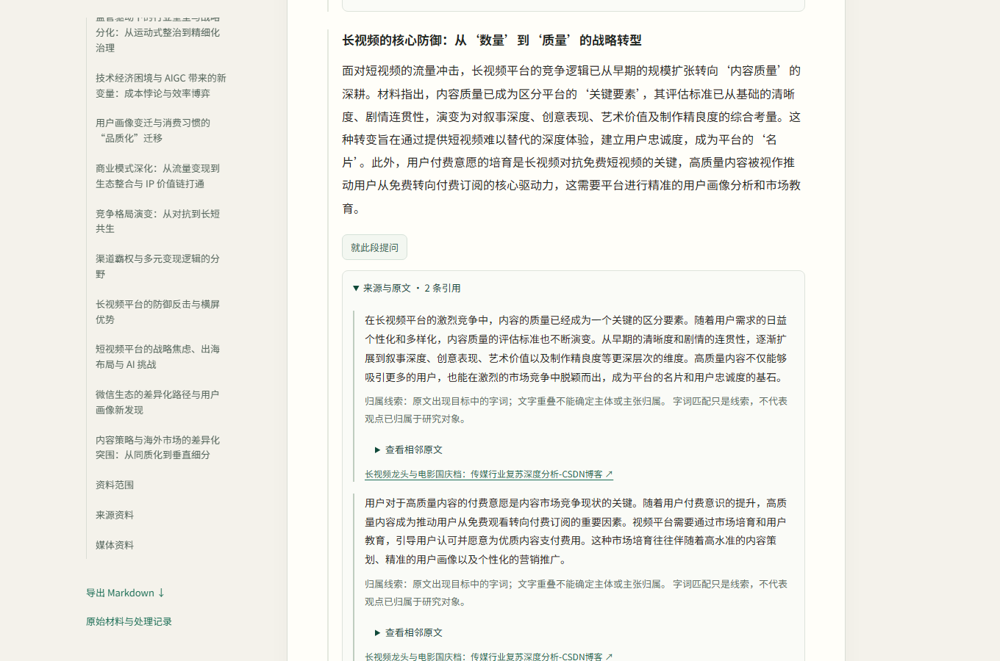

# 让研究记得从哪里出发

我希望研究能沿新发现继续，也能回到整个问题，判断当前方向、依据与投入是否合适。这些判断进入材料阅读、报告、来源回查与后继修订。

## 从一份具体报告进入

这份本地 Qwen3.5-9B 报告研究短视频与长视频竞争，按分发逻辑、用户场景、内容供给与商业模式等主题组织。目录、概览与正文保存在同一份报告中，可以沿章节展开到原文。

[同版本报告节选](../../report-excerpt.html)

## 表与回看

“表”保存思考的出发点、当前理解、依据、替代解释与缺口，随新材料更新。回看再把这些记录与原问题、实际投入接起来，决定继续深入、补查关系或换一个对象。

例如研究主流 TCG，某个游戏值得深入，但持续阅读同一个游戏也可能使其他重要对象长期没有推进。下一段时间怎样使用，需要同时认识已取得的内容及其对原问题的作用。

## 模糊前提

来源的一项判断可以提供调查线索；解释需要保留它的说话者、对象、时间与范围。线索进入规划或中间摘要后，仍须与自身依据相接。

在实际阅读中，段落、保存原文、网页出处和相邻上下文可以共同查看。来源回查使判断有可回到的对象，后继修订继续使用相应报告版本。

## 必要原文与正常说明

对于难以可靠改写的表达，保留必要原文和上下文；其他有依据的部分继续正常解释。模型选择原文地址，程序按地址取字。实际取舍仍需要看具体信息、正确内容和整篇可读性。

## 工具承接

Python、FastAPI、SQLite 与原生网页承接材料读取、报告编辑、版本、任务状态及暂停、继续。已有成果与正在进行的工作分别呈现，追问与修订对应确切材料和版本。

[返回枝析](../../zhixi.html)
